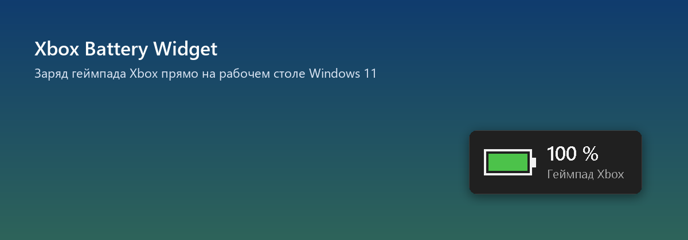
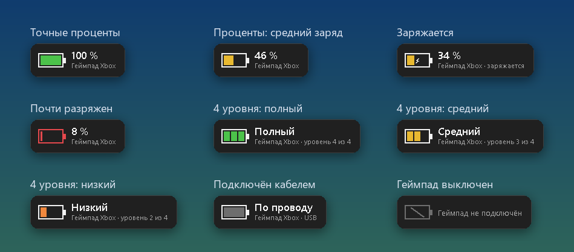
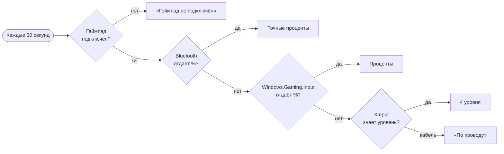

<div align="center">



# Xbox Battery Widget

**Маленький виджет для рабочего стола Windows 11: показывает заряд батареи беспроводного геймпада Xbox.**

[⬇️ Скачать XboxBatteryWidget.exe](XboxBatteryWidget.exe?raw=true) · Windows 10/11 · установка не нужна

</div>

---

## Что умеет

- 🔋 **Иконка батареи и уровень заряда** в аккуратном тёмном окошке без рамки.
- 🎯 **Точные проценты**, если Windows их отдаёт (геймпад по Bluetooth). Если нет, показывает **4 уровня**: пустой, низкий, средний, полный.
- 🔄 **Обновляется каждые 30 секунд** (и по кнопке «Обновить сейчас»).
- 🔌 Показывает, что геймпад **заряжается** или **подключён кабелем**.
- 💤 Если геймпад выключен, пишет **«Геймпад не подключён»**.
- 🖱️ **Перетаскивается мышью**, позиция запоминается.
- 🚀 **Запускается вместе с Windows** (можно выключить в один клик).
- 📦 **Один .exe-файл**: ничего устанавливать не нужно, Python тоже не нужен.

## Как выглядит



Цвет заливки подсказывает, пора ли заряжать: **зелёный** (50 % и выше), **жёлтый** (20–49 %), **красный** (меньше 20 %).

## Как запустить

1. Скачайте файл **[XboxBatteryWidget.exe](XboxBatteryWidget.exe?raw=true)**.
2. Положите его в постоянное место, например в `C:\Programs\XboxBatteryWidget\`.
   Не запускайте из папки «Загрузки», если потом собираетесь её чистить.
3. Дважды щёлкните по файлу. Виджет появится в **правом верхнем углу экрана**.
4. Перетащите его мышью куда удобно.

> **Windows может предупредить: «Система Windows защитила ваш компьютер».**
> Так бывает со всеми программами без платной цифровой подписи.
> Нажмите **«Подробнее»**, затем **«Выполнить в любом случае»**. Это нужно сделать только один раз.

### Меню (правый щелчок по виджету)

| Пункт | Что делает |
|---|---|
| Источник / Обновлено | Откуда взяты данные и время последнего обновления |
| Обновить сейчас | Обновить заряд, не дожидаясь 30 секунд |
| Поверх всех окон | Виджет не прячется под другими окнами |
| Запускать вместе с Windows | Включить или выключить автозапуск |
| Закрыть виджет | Выйти из программы |

## Как убрать автозапуск

Автозапуск включается сам при первом запуске. Выключить его можно **любым из двух способов**:

- **В виджете:** правый щелчок → снять галочку **«Запускать вместе с Windows»**.
- **В Windows:** `Ctrl + Shift + Esc` → вкладка **«Автозагрузка приложений»** → **XboxBatteryWidget** → **«Отключить»**.

### Полное удаление

1. Выключите автозапуск (см. выше).
2. Правый щелчок по виджету → **«Закрыть виджет»**.
3. Удалите `XboxBatteryWidget.exe`.
4. По желанию удалите папку с настройками: нажмите `Win + R`, введите `%APPDATA%\XboxBatteryWidget` и удалите её.

## Откуда берётся заряд

Windows отдаёт заряд геймпада разными способами, и не все они одинаково точны.
Виджет опрашивает их по очереди и берёт первый, который ответил:



| Источник | Что даёт | Когда работает |
|---|---|---|
| **Bluetooth** | Точные проценты (как в «Параметрах» Windows) | Геймпад подключён по Bluetooth |
| **Windows.Gaming.Input** | Проценты | Зависит от способа подключения |
| **XInput** | 4 уровня | Почти всегда, в том числе через адаптер Xbox |

> Для Bluetooth-геймпадов Windows.Gaming.Input иногда отдаёт неверные числа
> (например, 10 % при полном заряде), поэтому Bluetooth проверяется первым.

## Если что-то не так

Если виджет пишет «не подключён», хотя геймпад включён, или показывает странный заряд, запустите диагностику.
Откройте командную строку в папке с программой и выполните:

```
XboxBatteryWidget.exe --diag
```

Отчёт появится в файле `%APPDATA%\XboxBatteryWidget\diag.txt`. Там видно, что отдаёт каждый источник.
Приложите этот файл, когда будете сообщать о проблеме в [Issues](../../issues).

## Для разработчиков

Виджет написан на Python 3 и использует `tkinter`, `ctypes` (XInput, cfgmgr32) и [PyWinRT](https://github.com/pywinrt/pywinrt) (Windows.Gaming.Input).

| Файл | Назначение |
|---|---|
| `xbox_battery_widget.py` | Весь код виджета |
| `build.bat` | Сборка в один `.exe` через PyInstaller |
| `make_icon.py` | Генерирует `icon.ico` без сторонних библиотек |
| `requirements.txt` | Зависимости для сборки |

**Запуск из исходников:**

```bat
python -m venv .venv
.venv\Scripts\pip install -r requirements.txt
.venv\Scripts\python xbox_battery_widget.py
```

**Сборка exe:** запустите `build.bat`. Готовый `XboxBatteryWidget.exe` появится в корне проекта.

Настройки (позиция окна, «поверх всех окон») хранятся в `%APPDATA%\XboxBatteryWidget\settings.json`,
автозапуск — в реестре: `HKCU\Software\Microsoft\Windows\CurrentVersion\Run`, значение `XboxBatteryWidget`.
